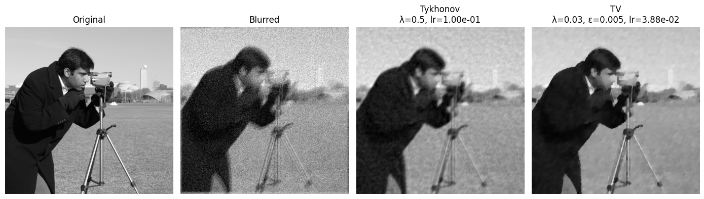
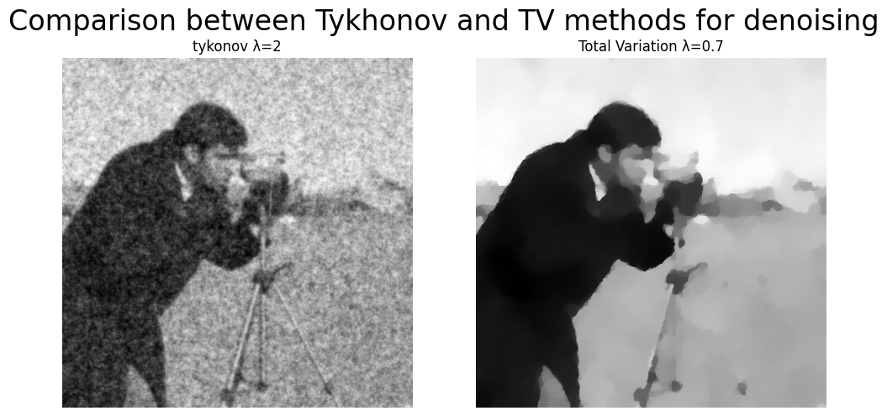

# Image restoration by variational optimization: Tikhonov vs Total Variation

Denoising and deblurring formulated as optimization problems, solved in closed form in the Fourier domain and by gradient descent in PyTorch.
Course project for 4IM01 (optimization methods for image restoration) at Télécom Paris, November 2025, with Micaela Gonzalez Dardik, supervised by Arthur Leclaire.



**[Read the report](report/report.pdf)** (12 pages)

## Problem

A degraded image is modelled as `v = A u + w`, where `u` is the clean image, `A` a degradation operator and `w` Gaussian noise.
The restored image minimizes a data-fidelity term plus a regularization term:

```
û = argmin_u  ½ ‖A u − v‖² + λ R(u)
```

Two regularizers are compared:

- **Tikhonov**, `R(u) = ‖∇u‖²`: a quadratic smoothness prior, with a closed-form solution in the Fourier domain.
- **Total Variation** (smoothed), `R(u) = Σ √(|∇u|² + ε²)`: it favours sparse gradients, so it keeps sharp edges, but it has no closed form.

All experiments use the 512×512 "cameraman" image.

## Method

- **Denoising** (`A = I`, noise σ = 0.5): Tikhonov is solved both in closed form (Fourier) and by gradient descent in PyTorch.
  The two solutions are almost identical (17.87 dB in closed form, 17.95 dB by gradient descent at λ = 2), which validates the gradient-descent implementation before applying it to TV.
  The small gap comes from the boundaries: periodic in the Fourier solution, zero gradient at the border in the PyTorch code.
- **Deblurring** (`A` = convolution with a known blur kernel, noise σ = 0.1): the convolution is computed by FFT with periodic boundaries, and both regularizers are solved by projected gradient descent (pixels kept in [0, 1]).
- **Step sizes** come from the Lipschitz constant of each gradient (it depends on λ, on ε for TV, and on the blur operator), so no learning rate is tuned by hand.
- **λ (and ε for TV)** is chosen by sweeping a range of values and comparing the restored images visually and with PSNR, SSIM, MSE and MAE.

## Results

**Denoising** (σ = 0.5):

| Method | λ | PSNR (dB) | SSIM |
|---|---:|---:|---:|
| Tikhonov | 2 | 17.95 | 0.337 |
| Total Variation (ε = 0.001) | 0.7 | 18.02 | 0.558 |



**Deblurring** (σ = 0.1):

| Method | λ | Iterations | PSNR (dB) | SSIM |
|---|---:|---:|---:|---:|
| Tikhonov | 0.5 | 500 | 23.52 | 0.576 |
| Total Variation (ε = 0.005) | 0.03 | 1500 | 25.07 | 0.668 |

In denoising, the two methods have almost the same PSNR, but TV is much better on SSIM, the structural metric: it restores edges that Tikhonov smooths out.
In deblurring, TV is better on both, by 1.5 dB of PSNR and 0.09 of SSIM.
The trade-off is that TV needs many more iterations and two parameters (λ and ε) instead of one, and it can leave flat, piecewise-constant patches in textured regions (the "staircase" effect visible on the grass above).

## Usage

```bash
pip install -r requirements.txt
```

Then run `image_restoration.ipynb` from top to bottom; it is kept with its outputs.
The noise is drawn without a fixed seed, so a new run gives slightly different scores (the report's tables differ from the notebook's by less than 0.2 dB).
The report states σ = 0.02 for deblurring, but the code, and the scores in the report's Table 4, use σ = 0.1.

The blur kernel in `kernels/` comes from the course material shared by Arthur Leclaire.
